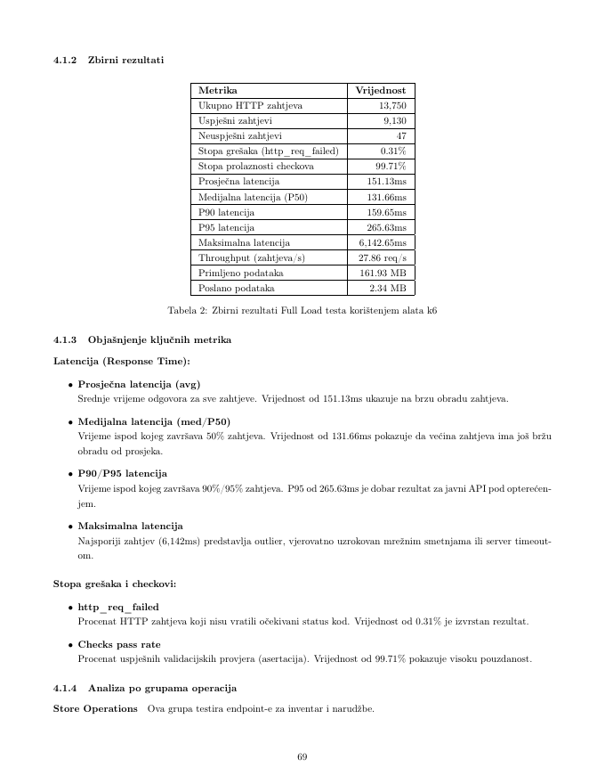
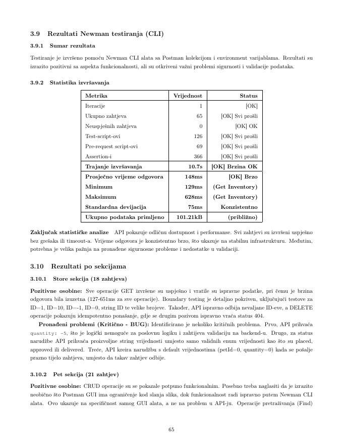
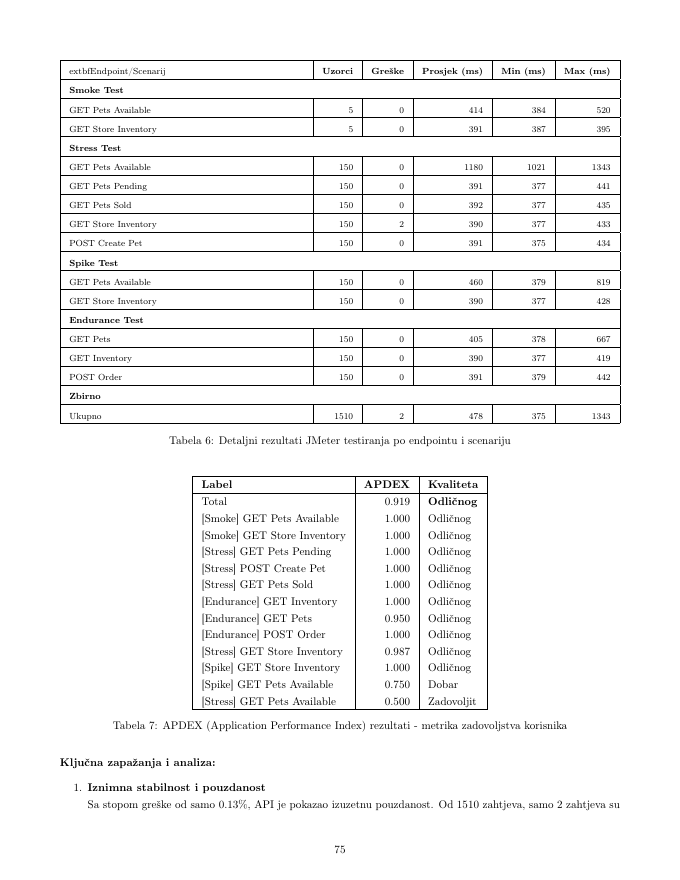
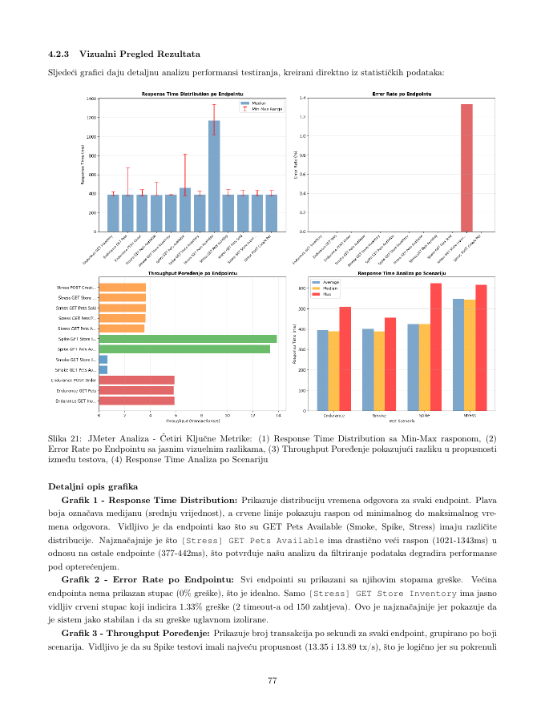
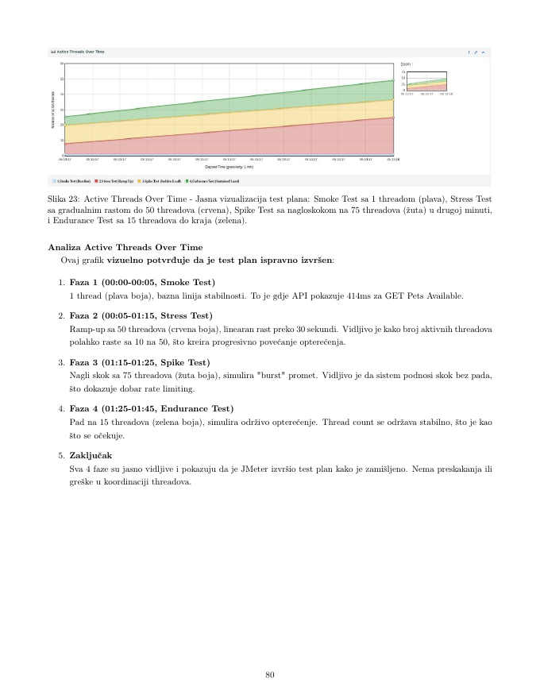

# Petstore API Quality Assurance & Performance Engineering Suite

[](./docs/reports/)
[](https://k6.io/)
[](https://jmeter.apache.org/)
[](https://www.postman.com/)
[](https://www.npmjs.com/package/newman)
[](./docs/reports/)
[](https://idzafic1.github.io/loadTestPetStoreAPI/)

---

## 📌 Executive Summary

This repository hosts a multi-tier **Quality Assurance (QA), Software Verification & Validation (VVS), and Performance Engineering Suite** evaluated primarily against the public **Swagger Petstore REST API v2** (`https://petstore.swagger.io/v2`), alongside extended web UI testing on **Swag Labs (SauceDemo)** and white-box algorithmic code analysis.

Rather than a simple one-off script, this project demonstrates end-to-end QA engineering methodologies spanning:
- **Black-Box Functional Testing & UI Automation** (Equivalence Partitioning, Boundary Value Analysis, Use Case Testing, Selenium IDE, NUnit C# Page Object Model).
- **Automated REST API Contract & Boundary Testing** (Postman & Newman CLI, 65 requests, 366 assertions, dynamic variables, defect detection).
- **Multi-Scenario Performance & Stress Testing** (k6 JavaScript engine: Smoke, Load, Stress, Spike; 13,750 requests, 27.86 req/s throughput, 0.31% error rate).
- **Comparative Load Benchmarking & Bottleneck Discovery** (Apache JMeter: 4 Thread Groups, 1,510 requests, APDEX 0.919, isolating latency degradation on GET /pet/findByStatus under 50 concurrent threads; root cause not investigated).
- **White-Box Testing & McCabe Cyclomatic Complexity** (Control flow graphs, basis path testing, branch/condition coverage).
- **Code Tuning & Fowler-Style Refactoring** (.NET/C# hot path micro-optimizations, eliminating LINQ overhead, caching, StringBuilder, and Visual Studio Code Metrics verification).
- **Automated Metrics Archiving & Interactive Visual Reporting** (Continuous JSON persistence, Chart.js compilation, and GitHub Pages deployment).

---

## 📑 Comprehensive QA Reports & Academic Documentation

A central highlight of this project is the inclusion of **two reports (87 and 60 pages)** available in the [`docs/reports/`](./docs/reports/) directory (as well as preserved at repository root as `VVSprojekat3.pdf` and `VVS.pdf`). These reports document every stage of testing, from initial test design to automated execution, performance benchmarking, and code refactoring.

### 📄 Report 1: API Functional & Performance Testing Comprehensive Report
🔗 **File**: [`docs/reports/api-and-performance-testing-report.pdf`](./docs/reports/api-and-performance-testing-report.pdf) *(87 Pages | Original: `VVSprojekat3.pdf`)*

This report provides an in-depth, 4-part quality assurance and performance study:

1. **Task 1 – Black-Box Functional Test Design (Swag Labs / SauceDemo)**:
   - **Methodologies**: Equivalence Partitioning (EP), Boundary Value Analysis (BVA), and Use Case Testing.
   - **Formulated Test Cases**: 5 formal test cases (TC-01: Valid user authentication happy path, TC-02: Locked-out user handling, TC-03: Checkout mandatory fields validation, TC-04: Product sorting by price, TC-05: Complete end-to-end checkout flow) formatted with prerequisites, steps, inputs, and expected outcomes ready for Azure DevOps Test Plans.
   - **Bug Reports**: Detailed defect documentation (BUG-01: Broken product images; BUG-02: Last name input field defect) including reproduction steps, expected vs. actual behaviors, severity ratings, and priority assignments.
2. **Task 2 – UI Test Automation (Selenium IDE & NUnit C#)**:
   - **Selenium IDE**: Recording, parameterizing, and replaying automated test scenarios.
   - **NUnit Selenium Framework**: Architecture and implementation of a modular C# automation framework leveraging the **Page Object Model (POM)** design pattern, separation of concerns, explicit element wait strategies, and multi-browser execution.
3. **Task 3 – Automated REST API Functional & Boundary Testing (Postman & Newman)**:
   - **Scope**: Complete test coverage across 3 functional modules:
     - **Store** (18 requests): Inventory status, order placement, order lookup by ID, order deletion.
     - **Pet** (21 requests): Creation, updates, queries by status, tag searches, image uploads, deletion.
     - **User** (24 requests): Single user creation, bulk array/list ingestion, authentication sessions (`login`/`logout`), user updates, and cleanup.
   - **Assertions**: 366 total automated assertions across 126 test scripts and 69 pre-request scripts achieving a **100% pass rate**.
   - **Critical Vulnerabilities & Bugs Uncovered**:
     - *Negative Order Quantities*: API accepted orders with `quantity: -5` without server-side validation.
     - *Enum Bypasses*: Order statuses accepted arbitrary invalid string literals instead of enforcing strict enum constraints (`placed`, `approved`, `delivered`).
     - *Ghost Records*: `POST /pet` with an empty body generated invalid records with huge random IDs rather than rejecting with `400 Bad Request`.
     - *Deprecation Headers Missing*: Deprecated endpoints (`/pet/findByTags`) remained active without deprecation notices.
4. **Task 4 – Comprehensive Performance, Load & Stress Testing (k6 vs. Apache JMeter)**:
   - **k6 Suite**: Multi-stage testing simulating up to 50 concurrent virtual users across 13,750 requests, measuring throughput, percentile latencies (p50, p90, p95), and automated threshold gates.
   - **Apache JMeter Suite**: 4 Thread Groups (Smoke, Stress, Spike, Endurance) with 1,510 requests calculating **APDEX (Application Performance Index)** scores.
   - **Root Bottleneck Identified**: Query filtering via `GET /pet/findByStatus?status=available` degraded to **1,180 ms average** and **1,343 ms maximum** latency under 50 concurrent threads (APDEX dropped to 0.500); latency degraded under 50 concurrent threads; root cause not investigated.

---

### 📄 Report 2: White-Box Testing, Code Tuning & Fowler Refactoring Report
🔗 **File**: [`docs/reports/whitebox-testing-and-refactoring-report.pdf`](./docs/reports/whitebox-testing-and-refactoring-report.pdf) *(60 Pages | Original: `VVS.pdf`)*

This report focuses on internal code structure, computational complexity, test coverage, and execution efficiency across 4 target business methods: `AnalizirajObavjestenja`, `AnalizirajPerformanseNarudzbi`, `AnalizirajStanjeInventara`, and `AnalizirajDobavljaca`:

1. **McCabe Cyclomatic Complexity & Control Flow Graphs (CFG)**:
   - Mathematical calculation of cyclomatic complexity $V(G) = E - N + 2P$ and $V(G) = D + 1$ (where $E$ is edges, $N$ is nodes, $P$ is connected components, and $D$ is decision predicate nodes).
   - Full visual control flow graphs mapping every decision branch, loop condition, and terminal node.
2. **White-Box Test Suite & Coverage**:
   - Systematic design of unit tests covering 100% Basis Path coverage, Branch coverage, Condition coverage, Loop boundary testing, and Exception handling.
3. **Performance Code Tuning (.NET / C#)**:
   - Micro-optimization benchmarks comparing execution durations and memory allocations:
     - Replacing iterative string concatenation with `StringBuilder` to eliminate intermediate heap allocations.
     - Caching `DateTime.Now` and collection `Count` outside loop boundaries.
     - Pre-allocating `List<T>` capacity to prevent repeated internal array resizing.
     - Replacing heavy LINQ pipelines (`.Where().Select().ToList()`) with optimized procedural loops in hot paths.
     - Early exits (`guard clauses`) and loop-invariant hoisting.
4. **Martin Fowler Code Refactoring & Metrics Verification**:
   - Identification of design code smells: *Long Method*, *Feature Envy*, *Primitive Obsession*, and *Complex Conditional*.
   - Systematic application of Fowler refactoring patterns (*Extract Method*, *Introduce Parameter Object*, *Decompose Conditional*).
   - Objective quality verification using **Visual Studio Code Metrics** before and after refactoring:
     - Substantial reductions in Cyclomatic Complexity.
     - Increases in the Maintainability Index (MI).
     - Reductions in Class Coupling and excessive Lines of Code (LOC).

---

## 🏛️ The 6 Pillars of QA Tested in this Repository

```
┌─────────────────────────────────────────────────────────────────────────────────────────────────┐
│                           PETSTORE QA & VERIFICATION LIFECYCLE                                  │
├─────────────────────┬─────────────────────┬─────────────────────┬───────────────────────────────┤
│ 1. Functional & UI  │ 2. API & Contract   │ 3. Load & Stress    │ 4. White-Box & Code Quality   │
│ - SauceDemo (Black) │ - Postman / Newman  │ - k6 (13.7k reqs)   │ - McCabe Complexity & CFG     │
│ - Equiv. Partition  │ - 65 Requests       │ - Smoke / Stress    │ - 100% Branch/Path Coverage   │
│ - Boundary Values   │ - 366 Assertions    │ - Spike / Endurance │ - .NET C# Code Tuning         │
│ - Selenium & NUnit  │ - Business Defects  │ - JMeter (APDEX)    │ - Martin Fowler Refactoring   │
└─────────────────────┴─────────────────────┴─────────────────────┴───────────────────────────────┘
                                           │
                                           ▼
┌─────────────────────────────────────────────────────────────────────────────────────────────────┐
│                     5. METRIC AUTOMATION & INTERACTIVE VISUAL DASHBOARD                         │
│  handleSummary() Hooks ──▶ JSON Archival (results/history/) ──▶ generate-unified-report.js ──▶  │
│                      Chart.js Interactive HTML Report & GitHub Pages                            │
└─────────────────────────────────────────────────────────────────────────────────────────────────┘
```

---

## 🎯 Target Endpoints & Test Profiles

### Endpoints Covered
- **Store Module**:
  - `GET /store/inventory` — Store inventory status map
  - `POST /store/order` — Place a new purchase order
  - `GET /store/order/{orderId}` — Fetch order details by ID
  - `DELETE /store/order/{orderId}` — Remove an existing order
- **Pet Module**:
  - `POST /pet` — Create a new pet entity
  - `PUT /pet` — Update existing pet information
  - `GET /pet/{petId}` — Fetch pet details by ID
  - `POST /pet/{petId}` — Update pet with form data
  - `DELETE /pet/{petId}` — Delete pet entity
  - `GET /pet/findByStatus` — Query filtering by status (`available`, `pending`, `sold`)
- **User Module**:
  - `POST /user` — Create single user
  - `POST /user/createWithArray` & `createWithList` — Ingest bulk user arrays
  - `GET /user/login` — Authenticate and obtain active session
  - `GET /user/{username}` — Retrieve user profile
  - `PUT /user/{username}` — Update user record
  - `DELETE /user/{username}` — Delete user profile
  - `GET /user/logout` — Terminate user session

### Multi-Scenario Testing Profiles
| Test Profile | Script | VUs (Concurrency) | Duration | Objective |
| :--- | :--- | :--- | :--- | :--- |
| **Smoke Test** | `smoke-test.js` / `quick-test.js` | 1 VU | 1 min | Baseline sanity verification; confirm HTTP 200 responses and healthy contract structures. |
| **Full Load Test** | `petstore-load-test.js` | 0 ➔ 20 ➔ 50 VUs | ~8.2 min | Progressive ramp-up through 4 scenarios measuring steady-state throughput and percentile degradation. |
| **Stress Test** | `stress-test.js` | 0 ➔ 100 VUs | ~4 min | Pushing the system beyond normal operating limits to detect breaking points and resource saturation. |
| **Spike Test** | `spike-test.js` | 0 ➔ 100 VUs | 30 sec | Sudden burst within 10 seconds to evaluate rate limiting, auto-recovery, and connection queuing. |
| **Newman Functional** | `petstore-collection.json` | 1 VU (Sequential) | ~11 sec | 65-request comprehensive functional contract, boundary value, and security logic validation suite. |

---

## 🛠️ Tools & Technologies

| Tool / Technology | Purpose |
| :--- | :--- |
| **[k6](https://k6.io/)** | High-performance load testing engine written in Go; test scripting in ES6 JavaScript with custom thresholds and metrics. |
| **[Apache JMeter](https://jmeter.apache.org/)** | Multi-scenario load/stress evaluation with APDEX score derivation and latency distribution charts. |
| **[Postman](https://www.postman.com/) & [Newman](https://www.npmjs.com/package/newman)** | Automated REST API functional testing, dynamic variable chaining, pre-request automation, and CLI execution. |
| **[Selenium IDE & NUnit C#](https://www.selenium.dev/)** | Automated browser UI verification utilizing the Page Object Model (POM) pattern. |
| **[Node.js](https://nodejs.org/) & Chart.js** | Automated metric compilation (`generate-unified-report.js`) producing responsive HTML visual dashboards. |
| **Bash** | Scripted test orchestration (`autoRun.sh`, `run-and-save.sh`, `save-results.sh`). |
| **GitHub Pages** | Continuous deployment of latest interactive load testing results. |

---

## 📁 Repository Structure

```text
loadTestPetStoreAPI/
├── docs/
│   ├── images/
│   │   ├── jmeter-active-threads.png       # JMeter thread groups progression over time
│   │   ├── jmeter-key-metrics.png          # 4 key JMeter metrics comparative analysis
│   │   ├── jmeter-results-table.png        # JMeter scenario breakdown & APDEX ratings
│   │   ├── k6-load-test-summary.png        # k6 full load test terminal summary
│   │   └── newman-test-summary.png         # Newman CLI test execution summary
│   └── reports/
│       ├── README.md                       # Summary index of attached formal QA reports
│       ├── api-and-performance-testing-report.pdf    # 87-page Black-box, UI, API & Performance report
│       └── whitebox-testing-and-refactoring-report.pdf # 60-page White-box, Complexity & Refactoring report
├── results/
│   ├── history/                            # Timestamped execution run archives (JSON)
│   ├── full_load_summary.json              # Latest k6 full multi-scenario load test metrics
│   ├── smoke_summary.json                  # Latest k6 smoke test metrics
│   ├── stress_summary.json                 # Latest k6 stress test metrics
│   ├── spike_summary.json                  # Latest k6 spike test metrics
│   └── report.html                         # Unified interactive Chart.js visual dashboard
├── autoRun.sh                              # Automated multi-cycle runner (5 iterations + cooldowns)
├── generate-unified-report.js              # Aggregates results/history JSONs into report.html
├── index.html                              # Root redirect landing page for GitHub Pages
├── petstore-collection.json                # Postman collection (65 requests across Store, Pet, User)
├── petstore-environment.json               # Postman environment variables & test parameters
├── petstore-load-test.js                   # k6 multi-scenario load test suite (Smoke, Load, Stress, Spike)
├── quick-test.js                           # Fast single-endpoint sanity check
├── run-and-save.sh                         # Interactive terminal menu runner with auto-archive
├── save-results.sh                         # Historical metric archive script and HTML report generator
├── smoke-test.js                           # Dedicated 1-minute baseline smoke test
├── spike-test.js                           # Dedicated 100-VU surge spike test
├── stress-test.js                          # Dedicated 100-VU ramp-up stress test
├── VVS.pdf                                 # Preserved original White-Box & Refactoring report (60 pages)
└── VVSprojekat3.pdf                        # Preserved original API & Performance Testing report (87 pages)
```

---

## 🚀 How to Run the Tests

### 1. Prerequisites
- **Node.js** (v18+)
- **k6** (v0.40+):
  ```bash
  # Debian/Ubuntu
  sudo gpg -k
  sudo gpg --no-default-keyring --keyring /usr/share/keyrings/k6-archive-keyring.gpg --keyserver hkp://keyserver.ubuntu.com:80 --recv-keys C5AD17C747E3415A3642D57D77C6C491D6AC1D69
  echo "deb [signed-by=/usr/share/keyrings/k6-archive-keyring.gpg] https://dl.k6.io/deb stable main" | sudo tee /etc/apt/sources.list.d/k6.list
  sudo apt-get update && sudo apt-get install k6
  
  # Fedora/RHEL
  sudo dnf install https://dl.k6.io/rpm/repo.rpm
  sudo dnf install k6
  ```
- **Newman** (for CLI Postman execution):
  ```bash
  npm install -g newman
  ```

---

### 2. Execution Commands

#### A. Quick Verification & Smoke Testing
```bash
# Minimal single-endpoint check:
k6 run quick-test.js

# Full 1-minute multi-endpoint baseline smoke test (1 VU):
k6 run smoke-test.js
```

#### B. Full Multi-Scenario Load Test (Recommended)
Executes Smoke, Load, Stress, and Spike scenarios concurrently with strict threshold enforcement (~8.2 minutes):
```bash
k6 run petstore-load-test.js
```

#### C. Targeted Stress & Spike Tests
```bash
# Stress test: Ramp to 100 concurrent VUs
k6 run stress-test.js

# Spike test: Surge to 100 VUs in 10 seconds
k6 run spike-test.js
```

#### D. Interactive Menu Runner
Provides an interactive CLI menu to pick between Quick, Standard, or Full test executions and automatically updates the archive and dashboard:
```bash
chmod +x *.sh
./run-and-save.sh
```

#### E. Automated Continuous Benchmark Cycles
Executes 5 consecutive full load test benchmark iterations with cool-down intervals, logging each run to history and compiling the visual dashboard:
```bash
./autoRun.sh
```

#### F. Functional API Testing with Newman
```bash
newman run petstore-collection.json -e petstore-environment.json
```

---

## 📊 Empirical Results & Key QA Discoveries

### 1. k6 Multi-Scenario Load Test Benchmark (13,750 Requests)
From the benchmark run documented in `results/full_load_summary.json` (493.2s duration, max 50 concurrent VUs, 1,143 iterations):

| Metric | Measured Value | SLA / Target Threshold | Result |
| :--- | :--- | :--- | :---: |
| **Total HTTP Requests** | **13,750** | — | Completed |
| **Throughput** | **27.86 req/s** | Continuous sustained load | ✅ Passed |
| **Failed Requests (`http_req_failed`)** | **43** (0.31%) | `< 15.0%` | ✅ Passed |
| **Assertion Checks Pass Rate** | **99.71%** | `> 90.0%` | ✅ Passed |
| **Average Response Time (`avg`)** | **151.13 ms** | — | Sub-200ms |
| **Median Response Time (`p50`)** | **131.66 ms** | — | High consistency |
| **90th Percentile (`p90`)** | **159.65 ms** | — | Stable |
| **95th Percentile (`p95`)** | **265.63 ms** | `< 2,000 ms` | ✅ Passed |
| **Maximum Response Time (`max`)** | **6,142.65 ms** | Network/timeout outlier | Tracked |
| **Total Data Received / Sent** | **161.93 MB / 2.34 MB** | — | Completed |

#### Operation Group Breakdown:
- **User Operations** (`Create User`, `Login`, `Get User`, `Logout`): **100.00% check pass rate** (1,143/1,143 checks passed). Average duration: **140.24 ms** (P95: 157.18 ms). Auth sessions proved resilient under high concurrency.
- **Pet Operations** (`Create`, `Get`, `Find`, `Update`, `Delete`): **99.13% – 100.00% pass rate**. Average creation time: **140.65 ms** (P95: 159.34 ms).
- **Store Operations** (`Inventory`, `Order`): **98.61% – 100.00% pass rate**. Order creation response times were 100% compliant. Inventory GET showed minor latency spikes under maximum concurrency.



---

### 2. Postman & Newman Functional Contract Findings
- **Execution**: 65 requests across Store (18), Pet (21), and User (24).
- **Assertions**: 366 passing assertions across 126 test scripts; duration 10.7 seconds; average response time: 148 ms.
- **Defects Discovered**:
  1. *Negative Order Quantities*: Ordering with negative integer values was accepted with HTTP 200 rather than rejected with `400 Bad Request`.
  2. *Enum Integrity*: Non-standard string status inputs were stored without schema validation.
  3. *Empty Body Ingestion*: `POST /pet` with empty JSON body instantiated empty records with generated IDs.



---

### 3. Apache JMeter Benchmark & System Bottleneck Identification
Evaluated across 4 Thread Groups (Smoke, Stress, Spike, Endurance) totaling **1,510 requests**:
- **Overall APDEX Score**: **0.919** ("Excellent").
- **Error Rate**: **0.13%** (only 2 timeouts encountered).
- **Critical Architectural Bottleneck Found**:
  - While simple ID lookups and write operations completed under 450 ms, `GET /pet/findByStatus?status=available` under 50-thread concurrent stress suffered severe latency spikes to **1,180 ms average** and **1,343 ms maximum** (APDEX fell to **0.500**).
  - **Latency Observation**: Latency degraded under 50 concurrent threads; root cause not investigated.

| JMeter Scenario Breakdown | APDEX & Key Metrics | Active Threads Progression |
| :---: | :---: | :---: |
|  |  |  |

---

## 📈 Metric Archiving & Visual Reporting

1. **`handleSummary` Data Extraction**: k6 test scripts automatically dump JSON metric files upon execution completion into `results/`.
2. **Persistence Pipeline**: `./save-results.sh` copies metrics into timestamped JSON files (`results/history/run_<TIMESTAMP>.json`).
3. **Automated Report Compilation**: `generate-unified-report.js` reads all historical runs and generates `results/report.html`, visualizing:
   - Latency percentiles across test executions.
   - Throughput (RPS) vs. Error rate trends.
   - Response time distribution histograms.
4. **Live Web Access**: Results are hosted directly via GitHub Pages:  
   👉 [https://idzafic1.github.io/loadTestPetStoreAPI/](https://idzafic1.github.io/loadTestPetStoreAPI/)

---

## 💡 Key QA Engineering Insights

1. **Percentile Analysis Trumps Averages**: The global average response time of 151 ms seemed exemplary, but 95th percentile tracking (265 ms) and tail latency outliers (> 6,000 ms) in k6 and JMeter revealed hidden database query bottlenecks.
2. **Contract Validation Must Precede Load Testing**: Stressing an API with high throughput is dangerous if the backend accepts logically invalid data (negative order quantities, unvalidated status strings). Functional contract validation must always form the foundation.
3. **Structured White-Box Testing Guarantees Coverage**: Calculating McCabe Cyclomatic Complexity and drawing Control Flow Graphs ensures no hidden branch or condition remains untested.
4. **Code Tuning Produces Measurable Gains**: Replacing heavy LINQ pipelines with tight loops, caching `DateTime.Now`, and using `StringBuilder` significantly reduced memory allocations and execution latency in performance-sensitive paths.

---

## 🇧🇦 Kratak pregled projekta (Bosanski jezik)

Ovaj repozitorij predstavlja sveobuhvatni **Quality Assurance (QA) i Software Verification & Validation (VVS)** portfolio razvijen na javnom **Swagger Petstore REST API-ju** i pratećim aplikacijama.

Repozitorij i priloženi detaljni izvještaji (87 stranica formalnog izvještaja za API i performanse, te 60 stranica za white-box testiranje u `docs/reports/` i korijenu projekta) obuhvataju:
1. **Black-Box testiranje i UI automatizaciju** (SauceDemo): Tehnike ekvivalentnog particionisanja, analize graničnih vrijednosti, use-case scenariji, kreiranje formalnih test case-ova i prijava bugova za Azure DevOps, te automatizacija kroz Selenium IDE i NUnit C# Page Object Model framework.
2. **Funkcionalno API testiranje** (Postman & Newman): Kolekcija od 65 zahtjeva i 366 asertacija (100% prolaznost) koja je otkrila ranjivosti poslovne logike na backendu (prihvatanje negativne količine narudžbe, nevalidni statusi, prazni POST unosi).
3. **k6 Load testiranje**: Izvršeno 13.750 HTTP zahtjeva kroz 4 scenarija (Smoke, Load, Stress, Spike) sa prosječnim odzivom od 151,13 ms i stopom greške od samo 0,31%.
4. **Apache JMeter analizu**: 1.510 zahtjeva i APDEX ocjena 0,919, uz lociranje kašnjenja na `GET /pet/findByStatus` pod opterećenjem od 50 niti (latencija skočila na 1.180 ms; korijenski uzrok nije istraživan).
5. **White-Box testiranje i McCabe metriku**: Kontrolni grafovi, bazne putanje, 100% pokrivenost grana i uslova za 4 ključne metode.
6. **Code Tuning i Fowler refaktoring**: Optimizacija C# koda (.NET) uklanjanjem LINQ-a u kritičnim petljama, keširanjem `DateTime.Now` i dužina kolekcija, upotrebom `StringBuilder`-a, te verifikacija poboljšanja kroz Visual Studio Code Metrics.
7. **Automatizovanu vizualizaciju**: Arhiviranje JSON metrika i generisanje interaktivnog HTML izvještaja sa historijskim pregledom trendova.
